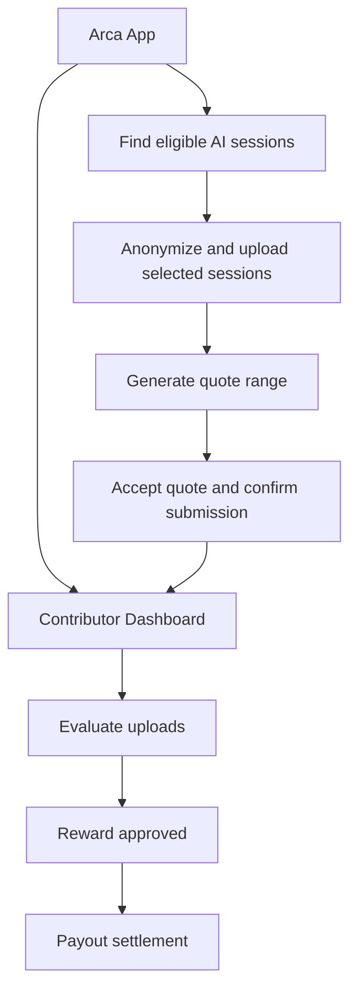

# 2. What is Arca

## What Contributors Can Submit

Contributors can submit private AI sessions from their coding tools, including:

* Claude Code and Codex sessions from desktop apps, CLI tools, VS Code extensions, and Cursor cloud agent.
* Eligible Claude Cowork sessions imported from Claude Desktop.
* Prompts, responses, tool usage, and other interactions within eligible sessions.
* Optional repo or workspace snapshots associated with those sessions.

Contributors can choose which sessions to submit, and Arca anonymizes them before upload.&#x20;

## How Arca Works

Arca has two contributor-facing components:

<table><thead><tr><th width="203.54296875">Component</th><th>What it does</th></tr></thead><tbody><tr><td><a href="7.-contributor-dashboard-guide.html">Contributor Dashboard</a></td><td>Web app where Contributors sign in, connect a GitHub account, browse open calls for data, track submissions and view earnings.</td></tr><tr><td><a href="6.-arca-app-guide.html">Arca App</a></td><td>Desktop app that finds eligible Claude Code, Codex, and Cowork sessions, anonymizes selected data, and packages each session for upload.</td></tr></tbody></table>

The system flow:

For Contributors, the workflow is straightforward:

1. Use the Arca App to find eligible AI sessions from supported local tools or connected accounts.
2. Select the sessions to submit, and optionally add the relevant repo or workspace.
3. Get a quote range once the upload completes and passes preliminary checks.
4. Accept the quote and confirm submission for final review.
5. Track its status in the Contributor Dashboard. Approved submissions are paid in USDC on the weekly payout.

## Notes for Contributors

Contributors should understand:

* Selected sessions and optional repo or workspace uploads may contain prompts, responses, tool outputs, code, and other private content. Arca anonymizes submitted data before upload, but you should still review what you choose to submit.
* Quote ranges are preliminary estimates and may change during final review. Rewards are issued only for approved submissions.
* If you don't accept the quote, withdraw and the upload is deleted.
